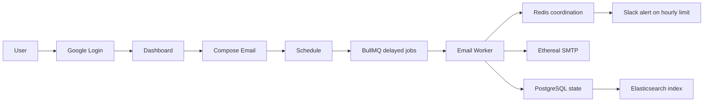
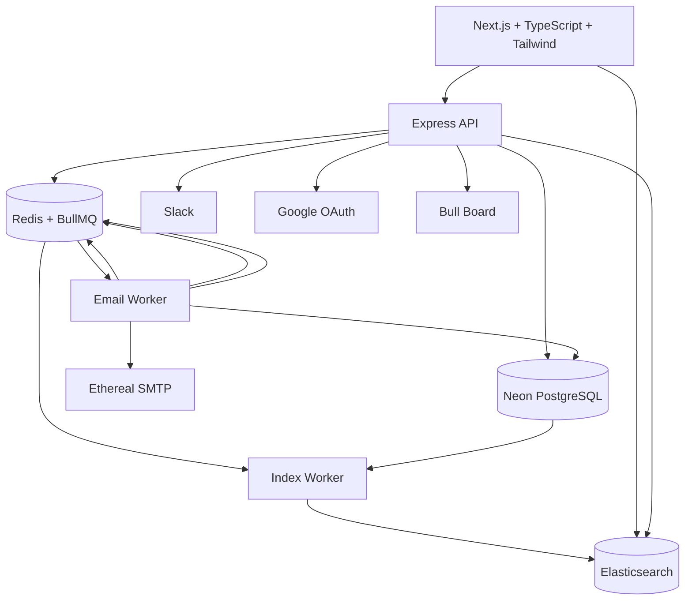
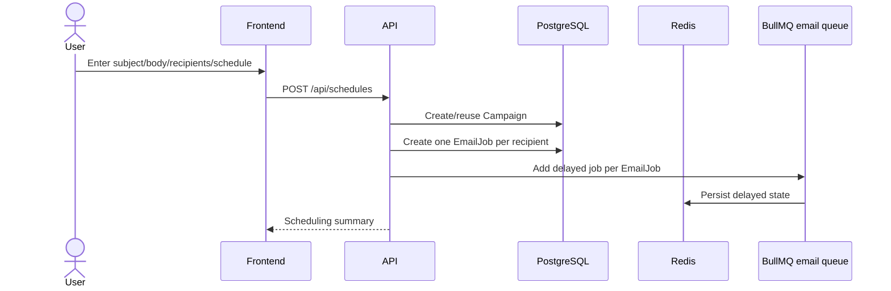
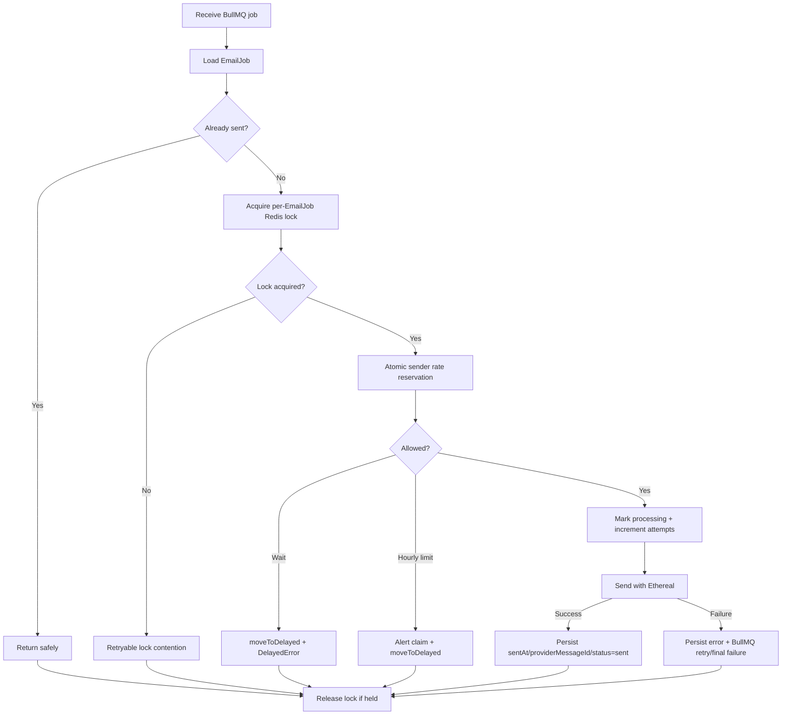
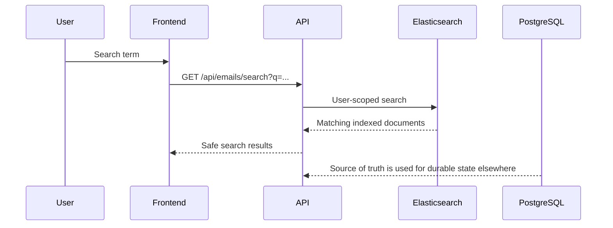
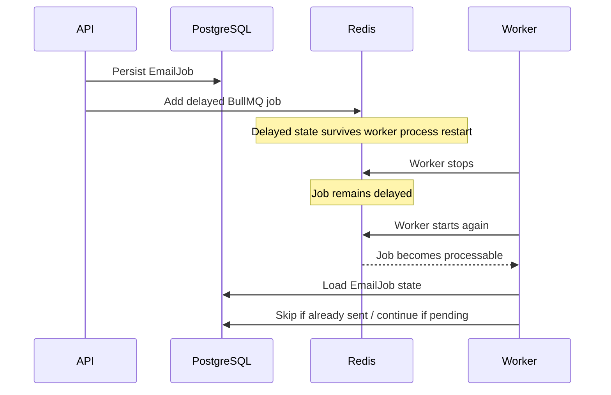
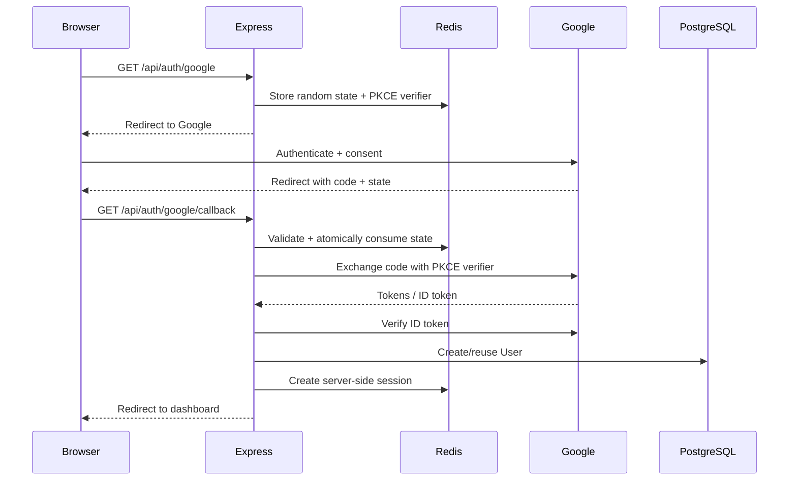
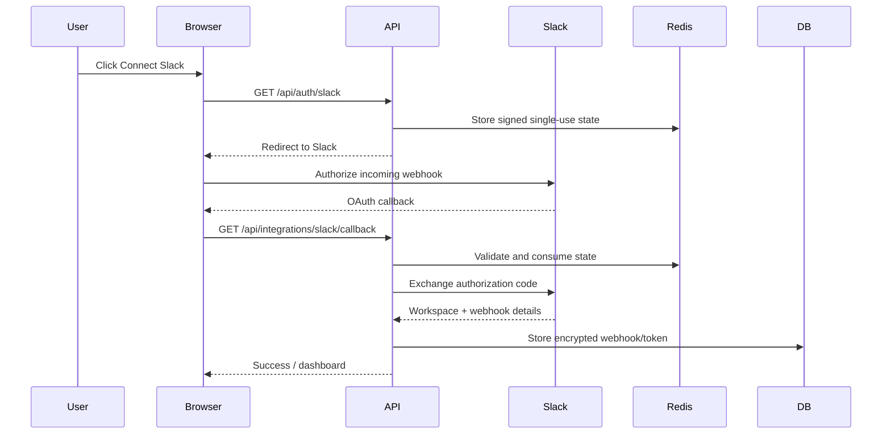
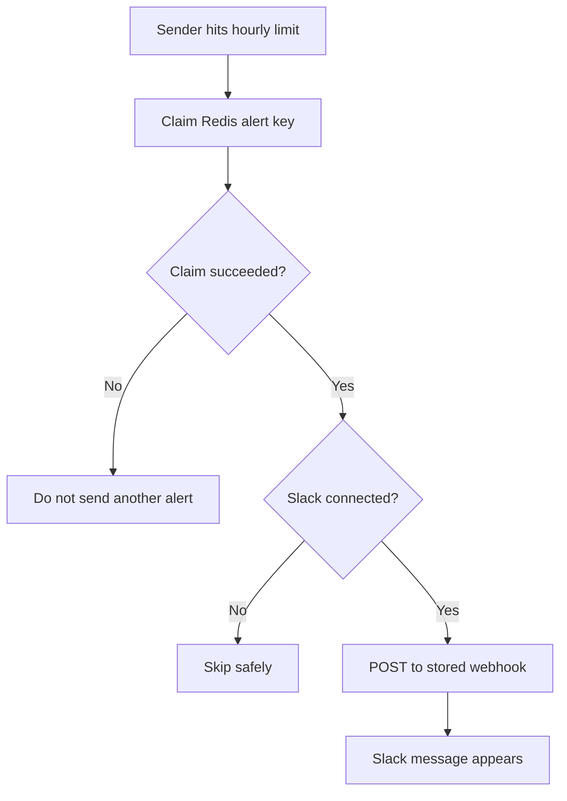
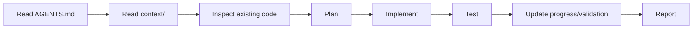

# ReachInbox — Full-stack Email Job Scheduler

A production-oriented email scheduling service and dashboard built for the ReachInbox Software Development Intern Assignment.

> **Important:** The assignment specification is the functional source of truth. The supplied Figma reference/screenshots are the visual source of truth. This README is intentionally detailed and is designed to be updated as the remaining frontend and final-verification phases are completed.

---

## Table of Contents

1. [What this project builds](#what-this-project-builds)
2. [Assignment requirements](#assignment-requirements)
3. [Technology stack](#technology-stack)
4. [Architecture](#architecture)
5. [Core flows](#core-flows)
6. [Why each technology is used](#why-each-technology-is-used)
7. [Problems and solutions](#problems-and-solutions)
8. [Persistence and restart recovery](#persistence-and-restart-recovery)
9. [Scheduling design](#scheduling-design)
10. [Concurrency and rate limiting](#concurrency-and-rate-limiting)
11. [Idempotency and duplicate-delivery protection](#idempotency-and-duplicate-delivery-protection)
12. [Elasticsearch search](#elasticsearch-search)
13. [Google OAuth](#google-oauth)
14. [Slack OAuth and notifications](#slack-oauth-and-notifications)
15. [Figma / UI implementation](#figma--ui-implementation)
16. [Repository structure](#repository-structure)
17. [Prerequisites](#prerequisites)
18. [Local infrastructure with Docker](#local-infrastructure-with-docker)
19. [Neon PostgreSQL setup](#neon-postgresql-setup)
20. [Environment variables](#environment-variables)
21. [Install dependencies](#install-dependencies)
22. [Database setup](#database-setup)
23. [Ethereal Email setup](#ethereal-email-setup)
24. [Google OAuth setup](#google-oauth-setup)
25. [Slack app setup](#slack-app-setup)
26. [Run the project](#run-the-project)
27. [Backend verification endpoints](#backend-verification-endpoints)
28. [API overview](#api-overview)
29. [Bull Board](#bull-board)
30. [Search and reindex](#search-and-reindex)
31. [Testing and verification](#testing-and-verification)
32. [Load behavior: 1,000+ emails](#load-behavior-1000-emails)
33. [Failure modes and recovery](#failure-modes-and-recovery)
34. [Security considerations](#security-considerations)
35. [Feature mapping to the assignment](#feature-mapping-to-the-assignment)
36. [Figma visual reference](#figma-visual-reference)
37. [Demo plan (under 5 minutes)](#demo-plan-under-5-minutes)
38. [Assumptions and trade-offs](#assumptions-and-trade-offs)
39. [Known limitations](#known-limitations)
40. [Development workflow](#development-workflow)
41. [Final submission checklist](#final-submission-checklist)

---

## What this project builds

This project is a small slice of a real outreach platform: a user logs in, composes an email, uploads a list of lead addresses, chooses a start time, delay, and hourly limit, and schedules the emails.

Each recipient becomes an individual durable email job. BullMQ stores and releases the work at the intended time. A dedicated worker sends through Ethereal SMTP. Redis coordinates concurrency, sender-level throttling, OAuth state, sessions, and delivery locks. PostgreSQL stores the durable business state. Elasticsearch provides searchable email records. Slack receives a real notification when a sender hits the configured hourly limit.

The application is explicitly designed **without cron jobs**.

### High-level product flow




---

## Assignment requirements

The original assignment requires the system to:

- accept email scheduling requests via API
- persist schedule/email state in MySQL or PostgreSQL
- schedule with BullMQ + Redis and **no cron jobs**
- send using Ethereal SMTP
- support multiple senders
- survive server restarts without losing future jobs
- maintain idempotency and avoid duplicate sends in normal replay/concurrency cases
- expose a live BullMQ dashboard
- support configurable worker concurrency
- enforce a minimum delay between individual sends
- enforce a configurable hourly email limit
- make rate limiting safe across workers/instances using Redis or DB-backed state
- reschedule rate-limited jobs instead of dropping/failing them permanently
- send a real Slack notification when a sender reaches its hourly limit
- implement real Google OAuth login
- provide Scheduled Emails and Sent Emails views
- provide CSV/text recipient upload and count detection
- provide start time, delay, and hourly limit controls
- provide loading, empty, and error states
- make scheduled/sent emails searchable using Elasticsearch
- match the supplied Figma design closely

---

## Technology stack

| Area | Technology | Role |
|---|---|---|
| Frontend | Next.js + TypeScript | Web application and routing |
| Styling | Tailwind CSS | Figma-aligned UI styling |
| Backend | Express.js + TypeScript | HTTP/API layer |
| Database | PostgreSQL on Neon | Durable business/source-of-truth data |
| ORM | Prisma 7 | Type-safe PostgreSQL access and migrations |
| Queue | BullMQ | Persistent delayed job scheduling |
| Queue storage | Redis 7 | BullMQ state, locks, rate limiter, sessions/OAuth state |
| SMTP | Ethereal + Nodemailer | Fake/test SMTP delivery |
| Search | Elasticsearch 9.x | Searchable email projection |
| Queue UI | Bull Board | Live BullMQ visibility |
| Authentication | Google OAuth | Real user authentication |
| Notifications | Slack OAuth + Incoming Webhooks | Rate-limit alerts |
| Local infra | Docker Compose | Redis + Elasticsearch |

### Why PostgreSQL is hosted on Neon

The assignment permits PostgreSQL/MySQL locally or through another deployment. This project uses Neon PostgreSQL so the database persists independently from local application restarts, while Redis and Elasticsearch remain easy to run locally through Docker.

### Why Redis is Dockerized

Redis is required for BullMQ and distributed coordination. Docker keeps the local runtime reproducible without requiring a native Redis installation.

### Why Elasticsearch is Dockerized

Elasticsearch is required for searchable email data. Running it locally in Docker keeps setup deterministic while allowing the application to use a real Elasticsearch cluster during development.

---

# Architecture

## System architecture




### Responsibility boundaries

**PostgreSQL** is authoritative for application state: users, senders, campaigns, recipient-level EmailJobs, and Slack integration records.

**Redis + BullMQ** is authoritative for pending work and coordination: delayed jobs, rate-limit reservations, delivery locks, OAuth state, and sessions.

**Elasticsearch** is a searchable projection. It is deliberately not the source of truth.

**Ethereal** is a test SMTP provider and is used only for demonstration/testing, not for production delivery.

**Slack** is an external notification target only.

---

## Core flows

### 1. Schedule flow




### 2. Worker delivery flow



### 3. Search flow



---

# Why each technology is used

## Next.js + TypeScript

The assignment permits React.js or Next.js. Next.js provides routing and a clean structure for a multi-screen app while keeping the UI strongly typed.

## Express + TypeScript

The assignment explicitly requires Express. The backend is kept modular so authentication, scheduling, queue infrastructure, integrations, and search remain separate concerns.

## PostgreSQL + Prisma

PostgreSQL provides durable relational state and Prisma gives typed schema/migrations/client access.

## BullMQ + Redis

BullMQ is the persistent job scheduler required by the assignment. Redis stores the queue state and also provides the atomic shared coordination needed for multi-worker rate limiting and locks.

## Ethereal

Ethereal provides fake SMTP suitable for a verifiable demo without sending real outreach emails.

## Elasticsearch

Elasticsearch provides fast text search across recipient email, subject, body, and status while PostgreSQL remains authoritative.

## Bull Board

Bull Board gives the required live visibility into delayed, waiting, active, completed, and failed queue jobs.

## Google OAuth + Redis sessions

Google provides real identity. Express sessions store only the application user ID server-side in Redis; the browser receives an HTTP-only session cookie.

## Slack Incoming Webhooks

Slack provides a real notification target when rate limits are hit. The integration is connected using Slack OAuth and the webhook URL is encrypted before persistence.

---

# Problems and solutions

| Problem | Why it matters | Solution |
|---|---|---|
| Future emails must survive restart | In-memory timers disappear | BullMQ delayed jobs persisted in Redis |
| Redis data itself must persist | Queue could otherwise disappear after Redis restart | Redis AOF + Docker persistent volume |
| 1,000+ simultaneous schedules | One timer per email is fragile | One durable EmailJob + one BullMQ job per recipient |
| Multiple workers could send the same email | Parallel workers can race | Per-EmailJob Redis lock + sent-state check |
| Rate limiting must work across instances | Memory counters disagree across workers | Sender-scoped atomic Redis Lua reservations |
| Minimum inter-send delay | Provider-style throttling must still work under concurrency | Redis next-send reservation |
| Hourly limit reached | Jobs must not be dropped | Move active BullMQ job to delayed state and retry later |
| Rate-limit delays should not burn normal retry attempts | Otherwise valid jobs become failed | BullMQ delayed state + `DelayedError` |
| Slack could be spammed with 500 alerts | Every blocked job could alert | Sender/hour Redis `SET NX` alert claim |
| Elasticsearch downtime | Search should not break email sending | Separate retryable `email-index` BullMQ queue |
| Search results must not cross tenants | Security boundary | Every search is filtered to authenticated user ID |
| SMTP + DB are not one transaction | Crash can happen after SMTP accepts | Idempotent state checks + explicit documentation of the external crash window |
| OAuth replay/forgery | OAuth state must be protected | Signed random state, Redis TTL, user binding, `GETDEL`, PKCE |
| Local DB management | Avoid unnecessary local DB infrastructure | Neon PostgreSQL |
| Local infra consistency | Redis and Elasticsearch need easy setup | Docker Compose |
| Visual drift from the supplied Figma | Generic UI would fail the design requirement | Screenshot-based visual reference + dedicated Figma refinement phase |

---

# Persistence and restart recovery

The restart requirement is one of the central design goals.




### Persistence layers

1. **PostgreSQL** retains the durable application state.
2. **Redis AOF** retains the queue/coordination state.
3. **Docker volume** keeps the Redis persistence data across container recreation/restarts.
4. **BullMQ delayed jobs** retain the future work item instead of relying on Node.js memory.

The verified development scenario is:

```text
Schedule future job
      ↓
Stop worker
      ↓
Job remains delayed
      ↓
Restart worker
      ↓
BullMQ processes future job
      ↓
EmailJob becomes sent
```

There is intentionally no cron scheduler in the system.

---

# Scheduling design

Every recipient becomes one logical email job.

For a campaign with:

```text
startTime = 10:00:00
minimum configured delay = 2 seconds
```

the intended initial schedule is:

```text
Recipient 1 → 10:00:00
Recipient 2 → 10:00:02
Recipient 3 → 10:00:04
Recipient 4 → 10:00:06
```

This is stored as `EmailJob.scheduledAt` and the corresponding BullMQ job is given a delay relative to the current time.

The important distinction is:

```text
scheduledAt = intended schedule
Redis limiter = actual send permission
```

The later Redis limiter may move a job further into the future if sender spacing or hourly capacity prevents an immediate send.

### No cron

The project intentionally does **not** use:

- OS cron / crontab
- node-cron
- Agenda
- Bree
- `setInterval` scheduler loops
- `setTimeout` as an application scheduler
- database polling as a scheduler

BullMQ delayed jobs remain the scheduling mechanism.

---

# Concurrency and rate limiting


## Worker concurrency

Worker concurrency is configurable through:

```env
WORKER_CONCURRENCY=10
```

The default is 10 in the current implementation.

This means several jobs can be active simultaneously, while Redis remains responsible for shared coordination.

## Minimum delay

The minimum delay is configured with:

```env
MIN_EMAIL_DELAY_MS=2000
```

The implementation keeps sender-specific next-send state in Redis.

Conceptual key:

```text
email:next-send:{senderId}
```

The reservation is made atomically so several workers cannot all decide that the sender is immediately available.

## Hourly sender limit

The configured limit is:

```env
MAX_EMAILS_PER_HOUR_PER_SENDER=200
```

The current implementation uses a UTC hour window.

Conceptual key:

```text
email:rate:{senderId}:{utcHourStart}
```

When the count reaches the configured limit, later work is moved into the next UTC hour window instead of being permanently failed.

## Atomicity

The limiter uses a Lua script with Redis server time so these operations are coordinated as one decision:

1. read current Redis time
2. determine the UTC hour bucket
3. inspect the sender's hourly count
4. inspect next-send time
5. reserve the next send slot if allowed
6. otherwise return the future timestamp when the job should retry

This protects the design when multiple worker processes or instances share the same Redis server.

---

# Idempotency and duplicate-delivery protection

There are two layers of protection.

## Database/job identity

Every recipient is represented by one `EmailJob`.

A deterministic BullMQ job ID maps back to the same logical EmailJob.

The database also uses uniqueness constraints for logical job identity.

## Redis delivery lock

A per-EmailJob lock prevents overlapping workers from reaching SMTP simultaneously.

Conceptual key:

```text
email:delivery-lock:{emailJobId}
```

The lock uses:

```text
SET key token NX PX <ttl>
```

and is released only when the stored token still matches the current token.

## Sent-state check

Before sending:

```text
if EmailJob.status == sent
    do not call SMTP
```

This was verified with replay tests.

## External exactly-once limitation

SMTP acceptance and PostgreSQL state persistence cannot participate in one atomic transaction.

Therefore this sequence remains theoretically possible:

```text
SMTP accepts message
        ↓
worker crashes
        ↓
PostgreSQL never receives SENT update
        ↓
lock eventually expires
        ↓
job can retry
```

The implementation reduces normal duplicate scenarios with deterministic IDs, database checks, and the Redis delivery lock, but it does **not** claim mathematically guaranteed exactly-once external SMTP delivery.

That limitation is documented intentionally rather than hidden.

---

# Elasticsearch search

Elasticsearch is a search projection, not a source of truth.

## Indexed fields

The email index contains safe fields such as:

- `id`
- `userId`
- `campaignId`
- `senderId`
- `recipientEmail`
- `subject`
- `body`
- `status`
- `scheduledAt`
- `sentAt`

No SMTP credentials, Slack tokens, webhook URLs, or application secrets are indexed.

## Why a separate index queue exists

Email delivery must continue even if Elasticsearch temporarily fails.

So the design uses:

```text
email queue
    ↓
SMTP delivery

email-index queue
    ↓
Elasticsearch indexing
```

The indexing queue is retryable and independent from delivery.

## Search API

Conceptually:

```http
GET /api/emails/search?q=meeting
GET /api/emails/search?q=rahul@example.com&status=sent
```

Results remain scoped to the authenticated user.

## Reindex

The backend provides a non-destructive reindex operation which reads authoritative EmailJobs from PostgreSQL and recreates/search-repopulates the Elasticsearch projection using the EmailJob ID as the document ID.

---

# Google OAuth

The authentication path is a real server-side Google OAuth authorization-code flow.



The implementation uses:

- `openid`
- `email`
- `profile`

and uses S256 PKCE.

The backend stores the application user ID in the Redis-backed session. The browser does not receive a Google client secret or OAuth token.

---

# Slack OAuth and notifications

The Slack integration is designed to satisfy the assignment's explicit requirement for a real OAuth connection and a real notification call.

## OAuth flow



## Rate-limit alert flow



Conceptual key:

```text
email:rate-alert:{senderId}:{utcHourStart}
```

Only one worker claims the alert for a given sender/hour.

### Slack behavior when disconnected

If Slack is not connected:

- email delivery continues
- rate limiting still works
- no crash occurs
- no Slack call is attempted

If Slack reconnects later, subsequent alerts use the newly stored integration without redeploying the application.

---

# Figma / UI implementation

The frontend must follow the supplied Figma design closely. The provided screenshots were used as the concrete visual reference.

### Visual language observed from the supplied reference

- white application canvas
- slim left navigation rail/sidebar
- green primary actions
- pale green selected navigation state
- subtle light-gray separators and input backgrounds
- compact typography
- large amounts of whitespace
- simple outlined controls
- small status/schedule pills
- right-aligned row action icons
- full-page compose experience rather than a generic centered compose modal


### Reference surfaces

The supplied screenshots cover:

- Login Screen
- Scheduled / Homepage view
- Sent / Homepage view
- Email detail
- Compose New Email initial state
- Compose Send Later panel
- Compose with recipient chips/list
- Compose with uploaded attachment/image state

### Important visual rule

Do not turn the Figma design into a generic SaaS dashboard.

Visual implementation should follow the screenshots for:

- layout
- spacing
- dimensions
- typography
- colors
- borders
- icon sizing
- button shape
- input treatment
- list row alignment
- scheduling panel position

The frontend functionality is intentionally implemented before final pixel-level refinement.

---

# Repository structure

The project is organized as a workspace/monorepo:

```text
reachinbox-email-scheduler/
│
├── AGENTS.md
├── CHANGELOG.md
├── README.md
├── pnpm-workspace.yaml
├── package.json
├── .env.example
│
├── context/
│   ├── 00-source-of-truth.md
│   ├── 01-assignment.md
│   ├── 02-decisions.md
│   ├── 03-architecture.md
│   ├── 04-data-model.md
│   ├── 05-api-contract.md
│   ├── 06-ui-reference.md
│   ├── 07-progress.md
│   ├── 08-validation.md
│   └── 09-demo.md
│
├── apps/
│   ├── backend/
│   │   ├── prisma/
│   │   │   ├── schema.prisma
│   │   │   └── migrations/
│   │   └── src/
│   │
│   └── frontend/
│
├── infra/
│   └── docker-compose.yml
│
└── docs/
    └── diagrams/
```

### Backend responsibility groups

Typical modules include:

```text
apps/backend/src/
├── auth/
├── config/
├── db/
├── integrations/
│   ├── ethereal/
│   ├── elasticsearch/
│   └── slack/
├── queue/
├── routes/
├── services/
└── utils/
```

### Frontend responsibility groups

The final frontend should keep reusable UI and feature logic separated, for example:

```text
apps/frontend/
├── app/
├── components/
├── features/
├── hooks/
├── lib/
└── types/
```

Exact folder names may evolve with implementation, but the assignment requires a clean, reusable structure and typed interfaces.

---

# Prerequisites

The provided setup guide specifies:

- **Node.js 18+**
- **PNPM 9+**
- **Docker + Docker Compose**

The current workspace uses PNPM 9.x.

> Source setup guide: the provided project setup document specifies Node.js 18+, PNPM 9+, and Docker/Compose for Redis and Elasticsearch. fileciteturn0file0L5-L10

---

# Local infrastructure with Docker

Redis and Elasticsearch are local Docker services.

## Start

From the repository root:

```bash
docker compose -f infra/docker-compose.yml up -d
```

Or from `infra/`:

```bash
cd infra
docker compose up -d
```

The provided setup guide uses this same Docker Compose workflow and documents Redis on port `6379` and Elasticsearch on port `9200`. fileciteturn0file0L12-L20

## Expected services

| Service | Port | Purpose |
|---|---:|---|
| Redis | 6379 | BullMQ, locks, rate limit, sessions/OAuth state |
| Elasticsearch | 9200 | Email search/indexing |

## Redis persistence

The Redis service is configured for persistence with AOF and a persistent Docker volume. Redis uses `noeviction` so queue state is not unexpectedly evicted.

## Health checks

The local stack should report both Redis and Elasticsearch as healthy before starting workers.

---

# Neon PostgreSQL setup

The application uses PostgreSQL hosted on Neon.

## Connection model

Two connection strings are used:

```text
DATABASE_URL → pooled Neon connection → application runtime
DIRECT_URL   → direct Neon connection → Prisma CLI/migrations
```

The Prisma configuration uses the direct connection for CLI/migrations while the runtime Prisma client uses the Neon adapter and the pooled connection.

## Do not create database tables manually

Use Prisma migrations/schema management from the repository so the database stays reproducible.

---

# Environment variables

Create the local backend environment file:

```text
apps/backend/.env
```

Start from the example file:

```bash
cd apps/backend
cp .env.example .env
```

The provided setup guide follows this same environment-file workflow. fileciteturn0file0L22-L36

### Core variables

| Variable | Purpose | Example/default |
|---|---|---|
| `DATABASE_URL` | Neon pooled runtime connection | secret / local only |
| `DIRECT_URL` | Neon direct migration connection | secret / local only |
| `REDIS_URL` | Redis/BullMQ connection | `redis://localhost:6379` |
| `ELASTICSEARCH_URL` | Elasticsearch connection | `http://localhost:9200` |
| `CREDENTIAL_ENCRYPTION_KEY` | Encrypt SMTP/Slack credentials at rest | generated secret |
| `SESSION_SECRET` | Sign application sessions | generated secret |
| `WORKER_CONCURRENCY` | BullMQ worker concurrency | `10` |
| `EMAIL_DELIVERY_LOCK_TTL_MS` | Per-email delivery lock lease | `900000` |
| `MIN_EMAIL_DELAY_MS` | Minimum sender spacing | `2000` |
| `MAX_EMAILS_PER_HOUR_PER_SENDER` | Sender hourly limit | `200` |

### Google OAuth

| Variable | Purpose |
|---|---|
| `GOOGLE_CLIENT_ID` | Google OAuth client ID |
| `GOOGLE_CLIENT_SECRET` | Google OAuth client secret |
| `GOOGLE_REDIRECT_URI` | OAuth callback URL |
| `FRONTEND_URL` | Frontend redirect/base URL |

### Slack OAuth

| Variable | Purpose |
|---|---|
| `SLACK_CLIENT_ID` | Slack app client ID |
| `SLACK_CLIENT_SECRET` | Slack app client secret |
| `SLACK_REDIRECT_URI` | Slack OAuth callback URL |
| `SLACK_STATE_SECRET` | Signing/validating OAuth state |

### Security rules

- Never commit `apps/backend/.env`.
- Never put server secrets in `NEXT_PUBLIC_*` variables.
- Never log database URLs, passwords, OAuth secrets, session secrets, webhook URLs, or encryption keys.
- `.env.example` contains placeholders only.

> The provided setup guide also explicitly calls out `CREDENTIAL_ENCRYPTION_KEY` and `SESSION_SECRET` as required core environment settings. fileciteturn0file0L31-L36

### Development authentication note

Earlier development scaffolding included an instant-login/dev-user path for early backend testing. The real Phase 7 authentication implementation removed that runtime development-user guard from normal protected APIs. **The final submission should use real Google OAuth.**

---

# Install dependencies

From the repository root:

```bash
pnpm install
```

The provided setup guide specifies installing all workspace dependencies from the root. fileciteturn0file0L38-L43

---

# Database setup

Use the repository's Prisma migration workflow.

Typical commands:

```bash
cd apps/backend
pnpm db:deploy
pnpm db:validate
pnpm db:generate
pnpm db:verify
```

If the project exposes the Prisma CLI directly, equivalent commands are:

```bash
pnpm prisma generate
pnpm prisma migrate deploy
```

> For this project, migrations are preferred over `prisma db push` because the schema is versioned and the assignment is intended as a reproducible project. The original setup guide mentions `db push`; the implementation evolved to use applied migrations for the actual Neon database.

---

# Ethereal Email setup

Ethereal provides fake SMTP delivery for testing/demo purposes.

## Sender model

The system supports multiple senders. Each sender stores encrypted SMTP configuration, including:

- sender email
- display name
- SMTP host
- SMTP port
- encrypted SMTP username
- encrypted SMTP password
- active state

## Seed test senders

The backend provides a development seed operation to generate/reuse Ethereal test accounts and persist their credentials encrypted.

Example:

```bash
pnpm --filter @reachinbox/backend ethereal:seed
```

The current seed flow creates at least two usable Ethereal senders so the multi-sender requirement can be demonstrated.

## Delivery behavior

```text
EmailJob
   ↓
Sender lookup
   ↓
Decrypt SMTP credentials
   ↓
Nodemailer transporter
   ↓
Ethereal SMTP
   ↓
provider message ID
   ↓
PostgreSQL SENT state
```

For test/demo messages, the worker may expose the Ethereal preview URL in logs where supported.

---

# Google OAuth setup

## 1. Create a Google OAuth client

In Google Cloud Console:

- create an OAuth client
- application type: **Web application**
- use the project name such as `ReachInbox Email Scheduler`

## 2. Authorized redirect URI

For the current local backend port, use:

```text
http://localhost:4000/api/auth/google/callback
```

This exact value must also appear in `GOOGLE_REDIRECT_URI`.

## 3. Consent / audience

For a personal development setup, configure the OAuth app for the appropriate external/test-user setup and add the Google account used for testing.

## 4. Local environment

```env
GOOGLE_CLIENT_ID="..."
GOOGLE_CLIENT_SECRET="..."
GOOGLE_REDIRECT_URI="http://localhost:4000/api/auth/google/callback"
FRONTEND_URL="http://localhost:3000"
SESSION_SECRET="..."
```

## 5. Login flow

Open the frontend login page and click the real Google login button.

The backend should:

1. generate random state
2. store it in Redis with TTL
3. generate S256 PKCE values
4. redirect to Google
5. validate and atomically consume state at callback
6. exchange the code
7. verify the Google ID token
8. create/reuse the PostgreSQL User
9. create the Redis-backed application session
10. redirect to the frontend dashboard

---

# Slack app setup

The assignment requires a real Slack OAuth connection and a real message sent to Slack when a sender reaches its hourly limit.

## 1. Create a Slack app

Start with a **Blank app**.

The application does not need slash commands, event listeners, or AI-agent functionality for this assignment.

## 2. OAuth permissions

Request the minimum required permission for the notification path, including:

```text
incoming-webhook
```

## 3. Redirect URL

Use the callback implemented by the backend, currently:

```text
http://localhost:4000/api/integrations/slack/callback
```

Set the same value in:

```env
SLACK_REDIRECT_URI="http://localhost:4000/api/integrations/slack/callback"
```

## 4. Credentials

```env
SLACK_CLIENT_ID="..."
SLACK_CLIENT_SECRET="..."
SLACK_REDIRECT_URI="http://localhost:4000/api/integrations/slack/callback"
SLACK_STATE_SECRET="a-long-random-secret-at-least-32-chars"
```

## 5. What gets stored

The backend stores the Slack workspace/channel metadata and encrypts the webhook/token values before persistence.

The frontend/API never exposes the raw webhook URL.

---

# Run the project

## Option A — start the full dev stack from the root

The provided setup guide exposes a root development command:

```bash
pnpm run dev
```

It also documents the individual frontend/backend dev commands. fileciteturn0file0L56-L75

## Option B — run each process separately

### Terminal 1 — infrastructure

```bash
docker compose -f infra/docker-compose.yml up -d
```

### Terminal 2 — backend API

```bash
cd apps/backend
pnpm run dev
```

Current backend development port:

```text
http://localhost:4000
```

### Terminal 3 — worker

Use the backend's worker development script as exposed by the project package scripts.

The worker is intentionally a separate process from the HTTP API so queue processing can continue independently.

### Terminal 4 — frontend

```bash
cd apps/frontend
pnpm run dev
```

Current frontend development port:

```text
http://localhost:3000
```

The provided setup guide documents these same development ports and commands. fileciteturn0file0L64-L75

---

# Backend verification endpoints

Useful local endpoints include:

```text
GET /health
GET /health/redis
GET /api/me
GET /api/emails/search?q=...
```

Expected basic health checks:

```text
http://localhost:4000/health
http://localhost:4000/health/redis
```

---

# API overview

The exact API contract is tracked in `context/05-api-contract.md`; the core routes are organized around the assignment requirements.

## Authentication

```http
GET  /api/auth/google
GET  /api/auth/google/callback
GET  /api/me
POST /api/auth/logout
```

## Scheduling

```http
POST /api/schedules
```

Conceptual request:

```json
{
  "senderId": "sender-id",
  "subject": "Meeting follow-up",
  "body": "Hi there...",
  "startTime": "2026-09-27T10:00:00.000Z",
  "delayMs": 2000,
  "hourlyLimit": 200,
  "recipients": [
    "alice@example.com",
    "bob@example.com"
  ]
}
```

## Email listing

```http
GET /api/emails?status=scheduled
GET /api/emails?status=sent
GET /api/emails?status=failed
GET /api/emails?status=sent,failed
GET /api/emails/:id
```

The comma-separated status form supports the assignment's Sent Emails view, which needs both `sent` and `failed` records.

## Search

```http
GET /api/emails/search?q=rahul@example.com
GET /api/emails/search?q=pricing&status=sent
```

## Slack

```http
GET    /api/auth/slack
GET    /api/integrations/slack/callback
GET    /api/integrations/slack
DELETE /api/integrations/slack
```

All protected endpoints derive ownership from the authenticated session rather than trusting client-provided user IDs.

---

# Bull Board

The assignment requires a live BullMQ dashboard.

Current route:

```text
http://localhost:4000/admin/queues
```

It should expose the email-delivery queue and the separate indexing queue used by Elasticsearch synchronization.

Typical states visible during the demo:

```text
Delayed → Waiting → Active → Completed
                         ↘ Failed
```

Bull Board is particularly useful in the demo because it visually proves that the system is using BullMQ rather than browser timers or cron.

---

# Search and reindex

The backend includes non-destructive search/index maintenance scripts.

## Initialize search index

```bash
pnpm --filter @reachinbox/backend search:init
```

## Reindex from PostgreSQL

```bash
pnpm --filter @reachinbox/backend search:reindex
```

## Verify search

```bash
pnpm --filter @reachinbox/backend search:verify
```

The reindex operation uses `EmailJob.id` as the Elasticsearch document ID so rerunning it does not create duplicate logical email documents.

---

# Testing and verification

The project uses a layered verification strategy.

## Unit-level logic

Examples include:

- recipient normalization
- scheduling calculation
- rate-limit decisions
- Redis reservation logic
- OAuth state validation

## Integration verification

Examples include:

- Neon connectivity
- Redis connectivity
- BullMQ job lifecycle
- EmailJob persistence
- worker behavior
- Elasticsearch indexing/search
- Slack state handling

## End-to-end verification

The following scenarios are expected to be demonstrated with real infrastructure:

### A. Schedule and send

```text
Frontend/API
   ↓
PostgreSQL
   ↓
BullMQ delayed job
   ↓
Worker
   ↓
Ethereal
   ↓
SENT
```

### B. Worker restart

```text
Schedule future job
   ↓
Stop worker
   ↓
Job remains delayed
   ↓
Start worker
   ↓
Job completes
```

### C. Minimum spacing

With:

```env
MIN_EMAIL_DELAY_MS=2000
```

concurrent jobs for one sender should reserve slots at least two seconds apart.

### D. Hourly limit

For a test configuration such as:

```env
MAX_EMAILS_PER_HOUR_PER_SENDER=3
```

verify:

```text
3 allowed
next jobs delayed
no permanent failure
next UTC hour becomes eligible
```

### E. Slack deduplication

Thirty simultaneous rate-limit hits for one sender/hour should result in one alert claim/notification attempt.

### F. 1,000-job behavior

Use mocked SMTP for the large test so the system behavior can be verified without sending a thousand real test messages.

---

# Load behavior: 1,000+ emails

The assignment explicitly asks how the system behaves when 1,000+ emails are scheduled around the same time.

The design is:

```text
1000 recipients
      ↓
1000 EmailJobs in PostgreSQL
      ↓
1000 BullMQ jobs
      ↓
worker concurrency = configurable
      ↓
Redis controls sender spacing + hourly capacity
      ↓
jobs beyond the capacity are moved to future delayed timestamps
```

### What does NOT happen

- jobs are not silently dropped
- a rate-limited job is not permanently failed
- all work is not held inside Node.js memory
- the system does not spawn 1,000 JavaScript timers

### What happens instead

The queue absorbs the burst, workers process in parallel, and Redis determines which sender can actually send next.

Order is preserved **as much as practical**, especially within a campaign via the job sequence/priority, but strict global ordering is not promised because multiple campaigns and concurrent workers can interleave.

---

# Failure modes and recovery

## Redis temporarily unavailable

The queue/coordination path becomes unavailable, so the correct operational response is to restore Redis and let BullMQ resume persisted work. The application must not silently switch to in-memory scheduling.

## Elasticsearch temporarily unavailable

Email delivery continues. Indexing work remains retryable through the indexing queue.

## Slack unavailable

Email delivery continues. Slack notification errors do not permanently fail an email job.

## Google OAuth callback failure

The auth state is single-use and short-lived, so failed/replayed callbacks are rejected rather than accepted as valid logins.

## Email worker crash

BullMQ and Redis retain pending work. A restarted worker can process the remaining jobs.

## Worker crashes after SMTP acceptance

This is the known SMTP/database atomicity window described in the idempotency section. The system does not claim impossible exactly-once behavior across independent systems.

---

# Security considerations

## Secrets

Never commit:

- PostgreSQL credentials
- Redis secrets if configured
- Google client secret
- Slack client secret
- Slack webhook URL
- SMTP password
- `SESSION_SECRET`
- `CREDENTIAL_ENCRYPTION_KEY`

## Authentication

User identity comes from the server-side session created after verified Google OAuth.

Client-supplied `userId` values are not trusted for ownership.

## OAuth state

OAuth state is:

- random
- signed
- user-bound
- short-lived
- single-use

## PKCE

Google OAuth uses S256 PKCE to protect the authorization-code exchange.

## Sensitive database fields

SMTP credentials and Slack webhook/token values are encrypted before persistence.

## Search isolation

Elasticsearch search always applies user scoping so a user cannot search another user's email records.

---

# Feature mapping to the assignment

> **Status below should be updated by the final verification phase before submission.**

## Backend

| Assignment feature | Implementation | Status at current README snapshot |
|---|---|---|
| Express + TypeScript | Express API | ✅ |
| PostgreSQL | Neon + Prisma | ✅ |
| BullMQ | `email` queue | ✅ |
| Redis | Dockerized Redis | ✅ |
| Delayed scheduling | BullMQ delayed jobs | ✅ |
| Persistent scheduling | Redis AOF + BullMQ + PostgreSQL | ✅ |
| Restart recovery | Worker restart verification | ✅ |
| Multiple senders | Sender model + Ethereal seed | ✅ |
| Ethereal SMTP | Nodemailer/Ethereal integration | ✅ |
| Idempotency | DB state + deterministic IDs + Redis lock | ✅ |
| Worker concurrency | `WORKER_CONCURRENCY` | ✅ |
| Minimum send delay | Redis sender next-send reservation | ✅ |
| Hourly rate limit | Redis sender/hour counter | ✅ |
| Multi-worker safe rate limiting | Atomic Lua reservation | ✅ |
| Rate-limit rescheduling | BullMQ `moveToDelayed` + `DelayedError` | ✅ |
| Order preference | Sequence/priority | ✅ |
| Elasticsearch | Search index + `email-index` queue | ✅ |
| Search API | `/api/emails/search` | ✅ |
| BullMQ dashboard | Bull Board `/admin/queues` | ✅ |
| Slack OAuth backend | Real Slack OAuth flow | ✅* |
| Slack notification | Real webhook path | ⏳ Live verification |
| Slack disconnect/reconnect | Integration lifecycle | ✅ |
| Google OAuth backend | Real OAuth + Redis session | ✅* |
| Google interactive login | Browser/manual verification | ⏳ Live verification |

## Frontend

| Assignment feature | Status |
|---|---|
| Next.js + TypeScript | ✅ scaffolded / functionality in progress |
| Tailwind CSS | ✅ scaffolded / refinement ongoing |
| Google login screen | ⏳ Phase 8 |
| Dashboard | ⏳ Phase 8 |
| Scheduled Emails table | ⏳ Phase 8 |
| Sent Emails table | ⏳ Phase 8 |
| Compose New Email | ⏳ Phase 8 |
| CSV/text upload | ⏳ Phase 8 |
| Recipient count | ⏳ Phase 8 |
| Start time / Send Later | ⏳ Phase 8 |
| Delay input | ⏳ Phase 8 |
| Hourly limit input | ⏳ Phase 8 |
| Loading/empty/error states | ⏳ Phase 8 |
| User name/email/avatar | ⏳ Phase 8 |
| Logout | ⏳ Phase 8 |
| Slack connect/disconnect UI | ⏳ Phase 8 |
| Figma visual fidelity | ⏳ Phase 9 |

The backend is already implemented through the authentication/search/rate-limiting phases; the remaining work is primarily the frontend and final live verification.

---

# Figma visual reference

The supplied Figma file is view-only and export is disabled, so this repository uses the screenshots supplied during implementation as the concrete visual reference.

The reference surfaces include:

```text
Login
Dashboard / Scheduled
Dashboard / Sent
Email detail
Compose initial
Compose Send Later
Compose recipient chips
Compose uploaded-content state
```

The generated design-reference image below is an explanatory visual derived from those screenshots. It is not intended to replace the original Figma file.


---

# Demo plan (under 5 minutes)

The assignment asks for a short demo, maximum five minutes.

## Recommended script

### 0:00–0:20 — Login

- Open the application.
- Click real Google login.
- Show the dashboard with name/email/avatar.

### 0:20–0:50 — Compose

- Click **Compose**.
- Enter a subject and body.
- Select sender.
- Upload a CSV/text list.
- Show detected recipient count.

### 0:50–1:20 — Scheduling

- Set start time.
- Set delay.
- Set hourly limit.
- Click **Send Later / Schedule**.

### 1:20–1:45 — Bull Board

Open:

```text
http://localhost:4000/admin/queues
```

Show the delayed email jobs.

### 1:45–2:15 — Scheduled view

Show the Scheduled Emails rows:

- email
- subject
- scheduled time
- status

### 2:15–2:40 — Sent view

Let a small test batch send through Ethereal.

Show:

- sent
- failed (if applicable)
- sent timestamps

### 2:40–3:00 — Search

Search for a recipient or subject term and show Elasticsearch-backed results.

### 3:00–3:30 — Rate limiting

Temporarily use a very small test hourly limit.

Show that later jobs are delayed rather than failed.

### 3:30–3:50 — Slack

Show the real Slack notification in the connected channel.

### 3:50–4:25 — Restart

- stop the worker
- show future jobs remain delayed
- restart the worker
- show the future job completes

### 4:25–4:45 — Final architecture summary

Briefly state:

```text
PostgreSQL = source of truth
Redis/BullMQ = persistent scheduling + coordination
Worker = delivery
Elasticsearch = search
Slack = notifications
```

---

# Assumptions and trade-offs

## PostgreSQL hosted on Neon

Chosen to keep the relational state durable and independent from local database containers.

## Redis and Elasticsearch in Docker

Chosen for local reproducibility and because these services are straightforward to run as containers.

## Per-sender rate limiting

The assignment allows either global or per-sender limits. Per-sender limiting was selected because the system must support multiple senders and the assignment explicitly gives per-sender rate limiting as an example.

## UTC hourly windows

The hourly counter uses UTC hour windows. This makes distributed behavior deterministic and avoids ambiguity between workers running in different environments.

## Conservative rate reservations

A send slot may be reserved before the SMTP call completes. If the process crashes or SMTP fails, the slot may still be consumed. This is conservative and safe from the perspective of avoiding rate-limit overruns, but it can reduce utilization slightly.

## Elasticsearch eventual consistency

Elasticsearch is not part of the delivery transaction. This prevents a search outage from turning successful SMTP sends into failed email jobs.

## Per-EmailJob delivery lock

A distributed Redis lock prevents concurrent worker executions of the same email job from entering SMTP at the same time.

## Exactly-once limitation

External SMTP acceptance and PostgreSQL persistence are independent systems. The project documents the resulting crash window rather than claiming an impossible global atomic guarantee.

## Ordering

Campaign sequence numbers and BullMQ priority are used to preserve order where practical. Absolute global ordering is not guaranteed under concurrent processing.

---

# Known limitations

1. **Live Google OAuth verification** must be completed with valid Google Cloud credentials in the final environment.
2. **Live Slack OAuth and webhook delivery** must be completed with valid Slack app credentials before the final demo is recorded.
3. Elasticsearch is eventually consistent with PostgreSQL.
4. Redis rate reservations are conservative when a worker crashes after claiming a slot.
5. Exactly-once delivery across SMTP and PostgreSQL cannot be mathematically guaranteed without a shared transaction boundary; the application instead uses deterministic job identity, database state, and Redis delivery locking to minimize duplicates.
6. Absolute global ordering is not guaranteed with multiple workers and multiple campaigns.

---

# Development workflow

The project follows a persistent-agent workflow so that coding agents do not depend on chat memory.



## Context files

```text
context/
├── 00-source-of-truth.md  → scope and rules
├── 01-assignment.md       → original assignment
├── 02-decisions.md        → locked architecture decisions
├── 03-architecture.md    → system design and flows
├── 04-data-model.md       → PostgreSQL schema
├── 05-api-contract.md     → HTTP API
├── 06-ui-reference.md     → Figma observations
├── 07-progress.md         → what is complete
├── 08-validation.md       → what was actually verified
└── 09-demo.md             → demo sequence
```

The repository, not a prior chat, is the persistent project memory.

## Agent rules

Every coding agent should:

1. read the repository context before editing
2. preserve locked decisions
3. avoid speculative features
4. never introduce cron-based scheduling
5. test actual behavior
6. update progress/validation/changelog after changes
7. clearly distinguish VERIFIED from NOT VERIFIED

---

# Final submission checklist

Before submitting the assignment, verify every item below with the actual running application.

## Backend

- [ ] Express + TypeScript
- [ ] Neon PostgreSQL connected
- [ ] Redis Docker service healthy
- [ ] BullMQ email queue working
- [ ] Delayed scheduling working
- [ ] Worker concurrency configurable
- [ ] Minimum send delay configurable
- [ ] Hourly per-sender limit configurable
- [ ] Redis-backed rate limiter works across multiple workers
- [ ] Rate-limited jobs are rescheduled, not dropped
- [ ] Multiple senders work
- [ ] Ethereal SMTP sends successfully
- [ ] Sent/failed states persist
- [ ] Duplicate normal replay is prevented
- [ ] Restart recovery demonstrated
- [ ] Elasticsearch indexing works
- [ ] Search works
- [ ] Search is user-scoped
- [ ] Bull Board visible
- [ ] Slack OAuth works live
- [ ] Slack notification appears in a real channel
- [ ] Slack disconnect/reconnect works

## Frontend

- [ ] Real Google login
- [ ] Name shown
- [ ] Email shown
- [ ] Avatar shown
- [ ] Logout works
- [ ] Scheduled emails view
- [ ] Sent emails view
- [ ] Sent + failed statuses supported
- [ ] Compose screen
- [ ] Sender selection
- [ ] Subject
- [ ] Body
- [ ] CSV/text upload
- [ ] Recipient count
- [ ] Start time
- [ ] Delay
- [ ] Hourly limit
- [ ] Schedule/Send Later
- [ ] Search
- [ ] Loading states
- [ ] Empty states
- [ ] Error handling
- [ ] Slack connect/disconnect UI
- [ ] Figma visual match checked screen-by-screen

## Submission

- [ ] Private GitHub repository created
- [ ] Required reviewer access granted
- [ ] README updated with final run/setup instructions
- [ ] Architecture documented
- [ ] Persistence documented
- [ ] Rate limiting documented
- [ ] Concurrency documented
- [ ] Feature checklist mapped to assignment
- [ ] Assumptions/trade-offs documented
- [ ] 5-minute demo recorded
- [ ] Restart scenario shown
- [ ] Real Slack notification shown
- [ ] No secrets committed

---

## Final architecture in one picture

```text
                         ┌───────────────────────┐
                         │     Next.js Frontend  │
                         │   Login / Dashboard   │
                         │ Compose / Search      │
                         └───────────┬───────────┘
                                     │
                                     ▼
                         ┌───────────────────────┐
                         │      Express API      │
                         │ Auth / Scheduling     │
                         │ Email / Slack / Search│
                         └───────┬───────┬───────┘
                                 │       │
                    ┌────────────┘       └────────────┐
                    ▼                                 ▼
            ┌────────────────┐                ┌──────────────────┐
            │ Neon PostgreSQL│                │ Redis + BullMQ   │
            │ source of truth│                │ persistent jobs  │
            └────────┬───────┘                │ locks / limits   │
                     │                        │ sessions / OAuth │
                     │                        └────────┬─────────┘
                     │                                 │
                     │                                 ▼
                     │                        ┌──────────────────┐
                     └───────────────────────►│ BullMQ Workers   │
                                              └──────┬─────┬─────┘
                                                     │     │
                                      ┌──────────────┘     └─────────────┐
                                      ▼                                  ▼
                               ┌────────────┐                    ┌──────────────┐
                               │ Ethereal   │                    │ Elasticsearch│
                               │ SMTP       │                    │ search index │
                               └────────────┘                    └──────────────┘
                                      │
                                      ▼
                               ┌──────────────┐
                               │    Slack     │
                               │ rate-limit   │
                               │ notification │
                               └──────────────┘
```

**No cron. Persistent queue. Distributed throttling. Real OAuth. Searchable email history. Figma-aligned dashboard.**

---

## License

This repository was created for the ReachInbox Software Development Intern Assignment and is intended for evaluation/demo use.
